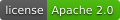
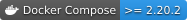
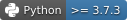

<div align = right>

&ensp;[<kbd> <br> EN <br> </kbd>](./README.md)&ensp;
&ensp;[<kbd> <br> RU <br> </kbd>](./README_RU.md)&ensp;

</div>

---

<table width="100%">
<tr><td align="center">


<hr>

<h4>Salt.Box is a web UI for <a href="https://saltproject.io/" target="_blank">SaltStack</a> configuration management</h4>

<a href="https://dev.saltbox.pro/saltbox/saltbox-compose/-/releases"></a>
<a href="./LICENSE.txt"></a>
<a href="https://img.shields.io/badge/Docker%20Engine-%3E%3D%2025.0-2496ED?logo=docker&logoColor=white"></a>
<br>
<a href="https://img.shields.io/badge/Docker%20Compose-%3E%3D%202.20.2-2496ED?logo=docker&logoColor=white"></a>
<a href="https://img.shields.io/badge/Python-%3E%3D%203.7.3-3776AB?logo=python&logoColor=white"></a>
<br>
<a href="https://dev.saltbox.pro/saltbox/saltbox-compose/-/pipelines?ref=dev"></a>
<h3>The official Salt.Box documentation</h3>

<a href="https://saltbox.pro/docs/intro/"></a>
<a href="https://saltbox.pro/docs/intro/"></a>

<!-- FIX: redirect on ru locale, currently both point to /docs/intro/ -->

</td></tr>
</table>


## Table of Contents

- **[About](#about)**
- **[Quick Start](#quick-start)**
  - [Requirements](#requirements)
  - [Install with `install-saltbox`](#install-with-install-saltbox)
- **[Manual Setup](#manual-setup)**
  - [Helper scripts](#helper-scripts)
  - [The startup script `update_and_run.sh`](#the-startup-script-update_and_runsh)
- **[Configuration](#configuration)**
  - [HTTPS](#https)
  - [Working behind a reverse proxy](#working-behind-a-reverse-proxy)
  - [External MongoDB](#external-mongodb)
- **[Operations](#operations)**
  - [Autotests](#autotests)
  - [Dev mode](#dev-mode)
  - [Cleanup](#cleanup)
  - [Run without Internet](#run-without-internet)
- **[Development agreements](#development-agreements)**
  - [Python scripts](#python-scripts)
  - [Docker Compose](#docker-compose)
  - [Redis: channels](#redis-channels)
  - [Keycloak](#keycloak)
- **[License](#license)**


## About

**Salt.Box** manages software configurations of workstations across hybrid IT
infrastructure: **hardware/software inventory, group policy administration,
application deployment, and migration to GNU/Linux**. Configuration tasks run
asynchronously against individual or grouped machines, can be triggered by
events, and are controlled through a single web UI with role-based multi-user
access, reporting, and an integration bus for extending the platform with
modules.

This repository, **`saltbox-compose`**, is the Docker Compose deployment of
Salt.Box – it bundles the SaltStack master with everything needed to run the
web UI as a single instance:

- **Keycloak** – authentication
- **Redis** and **RabbitMQ** – task/event delivery
- **MongoDB** – storage
- **OPA** – policy checks
- **Nginx** – TLS-terminating proxy in front of it all

> Configuration logic itself lives outside this repo, in separate SLS
repositories called [**Configuration Boxes**](https://dev.saltbox.pro/configuration.boxes)


## Environment requirements

> **NOTE:** Default Docker setup requires root access to operate. Prepend
> commands with `sudo` or switch to a superuser shell (`sudo -s`).

> **ATTENTION!** Adding your user to the `docker` group is effectively **root
> access** — it lets that user run privileged commands through the `Docker
> Engine`. Prefer [rootless mode](https://docs.docker.com/engine/security/rootless/) if this is a concern.

| Requirement     | Version    |
|-----------------|------------|
| GNU/Linux amd64 |            |
| Docker Engine   | >= 25.0    |
| Docker Compose  | >= 2.20.2  |
| Python\*        | >= 3.7.3   |

_\* Required by some helper scripts_


## Install with `install-saltbox`

Follow to [Install Salt.Box repository](https://dev.saltbox.pro/saltbox/install-saltbox/) for details.


## Helper scripts

Useful scripts are collected in the [`./bin/`](./bin/) directory. They are
supposed to be run from the repo root by relative path, e.g. `./bin/sb-compose.sh`.

| Script                           | Purpose                                                            |
|-----------------------------------|---------------------------------------------------------------------|
| `sb-compose.sh`                   | **Recommended way** to manage an instance. Passes aditional dotenv files to `docker compose` |
| `update_and_run.sh`               | Main startup script                                                  |
| `dotenv_tool.sh`                  | Read values from `env-files`, e.g. `./bin/dotenv_tool.sh list`         |
| `validate_dotenv.py`              | Check `override.env` for major issues                                |
| `make_secrets.py`                 | Create required system passwords                                     |
| `get_ca.sh`                       | Obtain the local CA `ca.crt` (optionally inject into Firefox)        |
| `sb-images-export.sh`             | Dump current images to disk, e.g. for an offline host                |
| `sb-images-import.sh`             | Load images dumped by `sb-images-export.sh`                          |
| `image_tags.py`                   | Check latest release tags for used images                            |
| `git_pull_dev_repos.py`           | _Dev only_ – update source Git repositories                          |

Script must be executable. Ensure with command:

```bash
chmod a+x ./bin/*
```

Scripts ineractions are reflected in [SCRIPTS_HIERARCHY.md](./SCRIPTS_HIERARCHY.md) document.


## Manual Setup

**Redis** requires memory `overcommit` – set it as a recommended host setting:

```bash
sudo sh -c "echo 'vm.overcommit_memory=1' > /etc/sysctl.d/saltbox.conf"
sudo sysctl -p /etc/sysctl.d/saltbox.conf
```

### The startup script `update_and_run.sh`

Easy way to startup the system is to execute:

```bash
# sudo may require
./bin/update_and_run.sh
```

The script:
- Makes secrets with `./bin/make_secrets.py`
- Updates Docker images
- Prints default administrator credentials
- Runs the Salt.Box instance with `./bin/sb-compose.sh`

Use `override.env` to redefine `base.env` default values. If addon modules are
connected with `_UPDATE_AND_RUN_EXTRA_ENV_FILES`, respective repositories must
me also cloned matching speicfied paths.

> **NOTE:**
> `override.env` has *HEIGHES* priority ans overrides all other values.
Note also previouse interpolations can NOT be changed by `override.env`. E.g.
some `SOME_PATH="${LOCAL_PATH}/file.yaml"` can not be changed by overriding
`LOCAL_PATH` later

- Use `-h` or `--help` flag to look script options

- To make the UI available on hostname or address other than `localhost` override
variables those defaults points to `localhost`

> **ATTENTION!**
>
> Check there are no warnings on not setted variables to avoid
confusing errors


## Configuration

### Precedence of dotenv files

`base.env` → overrides from `_UPDATE_AND_RUN_EXTRA_ENV_FILES` → `override.env`

### HTTPS

System requires HTTP connections to be **SSL** terminated. System creates a private
CA and a certificate for the web server on first run.

The authority certificate can be obtained with the command:

```bash
# sudo may require
./bin/get_ca.sh
```

> **ATTENTION!**
>
> System have to had been started at least once

It will be saved to `ca.crt` file in the current directory and may be installed
then into a web browser to trust the web UI site.

Generated certificate is bind to `localhost` and `saltbox.local` DNS names by
default. To change it override `WEB_SERVER_SSL_ALT_NAMES_DNS` variable and/or
`WEB_SERVER_SSL_ALT_NAMES_IP` to access the system by IP address rather than a
DNS name. Both variables may be in form of comma separate list.

- DNS names may be [RFC compliant wildcards](https://www.rfc-editor.org/rfc/rfc6125#section-7.2)
(`*.saltbox.local`, but not `*saltbox.local`)

- Wildcards for IP addresses are not supported

> **NOTE**: Restart the system to apply changes and recreate the certificate
---
*Out-of-the-box* certificate can be also replaced with a relative one:

```bash
# sudo may require
./bin/sb-compose.sh cp CUSTOM_CERT proxy:/etc/nginx/ssl/proxy.crt
./bin/sb-compose.sh cp CUSTOM_CERT_KEY proxy:/etc/nginx/ssl/proxy.key
```

> **ATTENTION!**
>
> System have to had been started at least once
>
> Changing `WEB_SERVER_SSL_ALT_NAMES_*` variables will lead to
overwriting the custom certificate with new generated one

### Working behind a reverse proxy

First, be sure to set `WEB_SERVER_OUTER_SOCKET` to match `server_name` and port
of the reverse proxy.

**Nginx** may be installed on the same host with **Salt.Box**, or on another one. In the last case be sure the **Salt.Box** is available for the **Nginx** host e.g. with command:

```bash
curl http://<SALTBOX_HOST>:<SALTBOX_WEB_SERVER_PORT>/auth/keycloak/realms/salt.box/.well-known/openid-configuration
```

**It should return long JSON response**.

An example Nginx config following.

```nginx
server {
  server_name <NAME>;
  client_max_body_size 256m;

  access_log /var/log/nginx/saltbox_access.log;
  error_log /var/log/nginx/saltbox_error.log;

  location / {
    add_header X-Frame-Options 'SAMEORIGIN';
    proxy_set_header Host $host;
    proxy_set_header X-Real-IP $remote_addr;
    proxy_set_header X-Forwarded-For $proxy_add_x_forwarded_for;
    proxy_set_header X-Forwarded-Proto $scheme;
    proxy_set_header X-Forwarded-Host $host;
    proxy_set_header Upgrade $http_upgrade;
    proxy_set_header Connection 'upgrade';

    proxy_pass https://<SALTBOX_HOST>:<SALTBOX_WEB_SERVER_PORT>;
  }

  listen 443 ssl http2;
  ssl_certificate <PATH_TO_CERT>;
  ssl_certificate_key <PATH_TO_CERT_KEY>;
  < OTHER SSL SETTTINGS DEPENDS ON CERT>
}

server {
  server_name <NAME>;
  listen 80;
  return 301 https://$host$request_uri;
}
```

> **NOTE**
> 1. Remember to set `WEB_SERVER_SSL_ALT_NAMES_*` variables in compliance
with `proxy_pass` URL
>
> 2. Remember to edit `< ... >` placeholders and check config with `sudo nginx -t`

### External MongoDB

By default **Salt.Box** runs its own bundled MongoDB replica-set member, the
`mongo` service, gated by the `mongo` Compose profile in
`COMPOSE_PROFILES`. On first start it provisions two database users: the
main one, `MONGO_USER`/`MONGO_DB`, used by Core, and a dedicated Migrations
one, `MIGRATION_MONGO_USER`/`MIGRATION_MONGO_DB`.

To connect to an already existing MongoDB replica set instead of the
bundled one:

1. Remove `mongo` from `COMPOSE_PROFILES` in `override.env` so the bundled
   container is not started
2. Point at the external cluster with either:
   - `MONGO_HOSTS` – comma-separated list of replica set members as
     `host[:port]`, port defaults to `27017`
   - `MONGO_URI` – a full connection URI that overrides `MONGO_HOSTS` and
     `MONGO_REPLICA_SET` entirely
3. Create the `MONGO_USER` and `MIGRATION_MONGO_USER` accounts on the
   external cluster yourself, with access to `MONGO_DB` and
   `MIGRATION_MONGO_DB` respectively, and put their passwords into
   `./secrets/mongo_user_password` and `./secrets/migration_mongo_user_password`

> **NOTE:**
> `MONGO_CACHE_SIZE_GB` only configures the bundled container's WiredTiger
cache – it has no effect on an external cluster


## Operations

### Autotests

To run test suites enable `compose-autotests.yaml` in the local `override.env`
file. Then execute:

```bash
# sudo may require
./bin/sb-compose.sh up autotests
```

Autotests depends on direct access to **API Keycloak**, so existing `realm` should be recreated. As alternative the `Direct access grants` checkbox may be checked at
Keycloak client settings.

To prevent pulling a new image:

```bash
# sudo may require
./bin/sb-compose.sh up autotests --pull=never
```

### Dev mode

#### Synopsis

Dev mode allows to build images instead of pulling pre-built and adds some
useful `env` overrides.

Look at [**Dev options**](https://dev.saltbox.pro/saltbox/saltbox-compose/-/blob/dev/base.env?ref_type=heads#L229-277) section of your [`base.env`](base.env) file copy.
To enable dev options uncomment required `COMPOSE_FILE=` lines. Than run
`compose` as usual.

> **NOTE:** Use `--watch` flag or toggle [**watch**](https://docs.docker.com/compose/how-tos/file-watch/) with `w` in attached mode to rebuld
dev-services on changes

> **ATTENTION!**
> Do not use development mode on production environments cause it
may change the data

#### Build images in dev mode

To build clean images use command with enabled `COMPOSE_FILE` overrides:

```bash
# sudo may require
./bin/sb-compose.sh build --no-cache
```

- `--no-cache` guarantees build with latest dependencies

#### Connect to redis-salt Redis instance

Dev mode allows to connect to the Redis instance by URL
`rediss://localhost:6379` (SIC!). Since TLS is enabled client may skip
a certificate validation (option like `--insecure`) or use a CA certificate.
The last may be obtained with command:

```bash
# sudo may require
./bin/get_ca.sh
```

> **ATTENTION!**
>
> System must be running

#### Dev minions

Dev mode provides amount of impersistent minions in replica mode. Look for
options in the [`base.env`](https://dev.saltbox.pro/saltbox/saltbox-compose/-/blob/dev/base.env?ref_type=heads#L266-268) file.

> **ATTENTION!**
>
> Dev minions does NOT keep their keys between restarts so keys will be dropped
on the master

Some operations may lead to lost minions. It that keys try the
following command, which should reconnect minions:

```bash
# sudo may require
./bin/sb-compose.sh restart salt-master
```

> **NOTE:**
> `./bin/sb-compose.sh up --force-recreate salt-master` not regenerates
minions

#### Dev Git repositories updater

Helper `git_pull_dev_repos.py` script pulls changes for Git repositories, attached as a `build context` or a `volume` in dev overrides:

```bash
./bin/git_pull_dev_repos.py
```

It invokes by `./bin/update_and_run.sh` every time if current directory is a
Git repository and `HEAD` is on a branch

### Cleanup

#### Cleanup all data

After changes created containers and *volumes* may become incompatible with
current code without special migrations.

To fix startup problems on developement environment stop containters with `^C`
and make them down:

```bash
# sudo may require
./bin/sb-compose.sh -f compose.yaml -f compose-dev-override.yaml down --volumes
```

> **ATTENTION!**
> The `--volumes` flag will **PURGE** attached *volumes* and will lead
to data lost. Be sure to not lost production data

#### Cleanup Keycloak data only

Run following commands:

```bash
# sudo may require
./bin/sb-compose.sh down
./bin/sb-compose.sh down keycloak-db --volume
```

On the next start the realm will be recreated.

#### Cleanup stale Docker stuff

While changing code and configs new layers and other objects are created. To
free resources run time to time the following command:

```bash
# sudo may require
docker system prune --force
```

- Usually it is safe and deletes only stale data.

### Run without Internet

**Salt.Box Compose** needs Internet connection to get images. And also Salt.Box utilizes Internet connection to download [**Configuration Boxes**](https://dev.saltbox.pro/configuration.boxes).

Suppose there is a target *offline host* to setup the Salt.Box AND it already has [Salt.Box Compose
requirements](#requirements) are installed. <u>The way to bring images on it is</u>:

1. On a host with an Internet link configure and run **Salt.Box** once by standard manual. `override.env`
   Compose config MUST be the same with the target offline host at least in a part of connected
   Compose-files

   > **NOTE:**
   > Enabled [Compose dev overrides](#dev-mode) with `service[].build` sections may require additional base images to be transferred manually

2. Export images with `[sudo] ./bin/sb-images-export.sh` command. The **Salt.Box** install may be stopped but
   not downed. Images will be saved into `./images/` directory by default

3. Put local git repositories of required SLS repositories a.k.a [**Configuration Boxes**](https://dev.saltbox.pro/configuration.boxes)
   into `LOCAL_CONFIG_BOXES_PATH` directory (`./_local-config-boxes/` inside
   Compose directory by default)

4. Add the new repositories on «Configuration Templates» page with URLs in form of
   `file:///mnt/config-boxes/REPO_NAME` where `REPO_NAME` corresponds to local repository name

5. On «Configuration Templates» page of the offline instance switch every added
   repository on and click «Connect» button in actions next to the switch.
After click «Sync». Check new files are obtained with `[sudo] ./bin/sb-compose.sh exec
salt-master salt-run fileserver.file_list`

   - The local Salt Master must be enabled

6. Copy the `saltbox-compose` directory including the `images/` directory on the target offline host.
   Change current working directory to the new `saltbox-compose` one. If some modules are connected
   with `_UPDATE_AND_RUN_EXTRA_*` env variables, __corresponding directories must be also copied__

7. Import images with `[sudo] ./bin/sb-images-import.sh` command

8. Run the [startup script](#the-startup-script-update_and_runsh):
   `[sudo] ./bin/update_and_run.sh --no-pull`. `--no-pull` flag makes Compose uses
local images

9. Add local repositories on «Configuration Templates» page again as in an earlier step

Later when Manifest `sshfs_files` sections of SLS repositories will be changed the AUX files may be
synced on an online instance and be copied on an offline one. AUX files should be copied with
checksum files from `SSHFS_STORAGE_PATH` directory (`./_sshfs-storage/` inside Compose directory by
default).


## Development agreements

### Python scripts

Python scripts in the `./bin/` subdirectory supposed to be compatible and free
from dependencies (other than The Python Standard Library).

To maintain the scripts it is recommended to run an appropriate environment
with LSP:

```bash
uv sync --python 3.14
source .venv/bin/activate
```

In contrast scripts MUST be tested with the lesser compatible Python version
(`v3.7.3`). E. g.:

```bash
pyenv install
pyenv exec python3 ./bin/make_secrets.py
```

- The [pyenv](https://github.com/pyenv/pyenv) utility takes version from the
[`./.python-version`](./.python-version) file. Installation required once

### Docker Compose

- `healthcheck.{interval,timeout,start_period,start_interval}` keywords
introduced in Docker Compose 2.20.2, it is a __current version limiter__
- `develop` specification introduced in Docker Compose `2.22.0`, it should be
avoided in the main [`compose.yaml`](compose.yaml) file
- Avoid default value notation for variables `'{VAR:-value}'` beacause default
values in [`base.env`](./base.env) is more explicit

### Redis: channels

Hash name shoud be in form of `OBJ_TYPE:{ID}:DATA_TYPE` e.g.
`minion:{MID}:grains`. Also mention single form of obj type and plural form for
data type, because there are many values for the object.

### Keycloak

Keycloak administrative interface: http://localhost/auth/keycloak/.
User `admin`, password from `./secrets/keycloak_admin_password`.


## License

Salt.Box Compose is distributed under the **Apache License 2.0** – see
[`LICENSE.txt`](./LICENSE.txt) for the full text.
